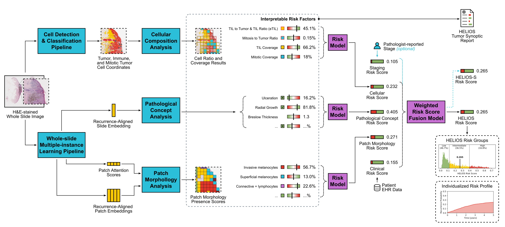

# HELIOS

End-to-end computational-pathology pipeline that predicts melanoma recurrence
risk from H&E whole-slide images (WSIs).



HELIOS (**H**ematoxylin & **E**osin-based **L**esion **I**nformed **O**utcome
**S**core) turns a routine H&E slide into a transparent, biologically grounded
recurrence-risk assessment. Instead of a single black-box number, it routes each
slide through parallel, individually interpretable branches and fuses them into
one continuous risk score that a pathologist can audit factor by factor.
Developed and validated across 2,860 early-stage patients on three continents, it
outperformed AJCC staging in every external cohort while staying interpretable by
design.

This repository is the open-source framework: a modular, config-driven,
reproducible pipeline so the community can extend each branch, swap in new
foundation models, validate on new cohorts, and build clinically deployable,
explainable risk tools on a shared foundation.

> **Status: scaffold.** The runtime seams -- config, path resolution, IO, model
> base classes, stage/component wiring, and the CLI -- are implemented and
> runnable on synthetic fixtures. The per-component **domain logic is stubbed**
> (`raise NotImplementedError`); this is the surface to port existing
> script/notebook code into. See [CONTRIBUTING.md](CONTRIBUTING.md).

## Why HELIOS

One score, decomposable into the evidence behind it. Each slide is scored by five
parallel branches, each interpretable on its own:

- **Whole-slide representation** -- attention-based multiple-instance learning
  (A-MIL) over foundation-model tile features, with the attention map showing
  *where* the model looked.
- **Cellular composition** -- quantitative cell detection, classification, and
  mitosis counting aggregated into per-slide features.
- **Pathological concepts** -- linear probes that decode human-readable concepts
  (thickness, ulceration, mitoses, growth pattern, …) from the slide embedding.
- **Patch morphology** -- unsupervised clustering of high-attention regions into
  recurring morphological phenotypes whose presence carries risk.
- **Clinical staging** -- the structured clinical and AJCC-staging signal.

A small, transparent fusion model (logistic regression / random forest) combines
the branch scores into the final HELIOS risk, so every prediction can be traced
back to the factors that drove it.

## Quickstart

```bash
make install        # uv sync: creates .venv, installs helios + dev tools
make shell          # load .env and activate the project environment
make test           # end-to-end smoke run of the pipeline on synthetic fixtures
make lint           # ruff + mypy
helios --help       # browse the full command tree
```

`make test` runs the whole prep → fit → predict → report flow on a synthetic
cohort (no real data required), so you can confirm the wiring works before
touching a slide.

### Foundation-model setup and Hugging Face access

The basic installation is sufficient for development and the synthetic test
suite. To run every tile encoder--particularly CONCH and MUSK, whose official
Python packages are installed from their source repositories--install the
foundation-model extra:

```bash
uv sync --extra dev --extra foundation-models
```

Several model repositories require accepting model-specific terms before their
weights can be downloaded. Sign in to your personal Hugging Face account in a
browser and request access on the page for each model you intend to use:

- [Virchow2](https://huggingface.co/paige-ai/Virchow2)
- [UNI](https://huggingface.co/MahmoodLab/UNI) and
  [UNI2](https://huggingface.co/MahmoodLab/UNI2-h)
- [CONCH](https://huggingface.co/MahmoodLab/CONCH) and
  [TITAN/CONCH 1.5](https://huggingface.co/MahmoodLab/TITAN)
- [Prov-GigaPath](https://huggingface.co/prov-gigapath/prov-gigapath)
- [MUSK](https://huggingface.co/xiangjx/musk)

Access belongs to an individual Hugging Face user, not merely to an
organization, and some repositories require manual approval. Complete this
step before starting a large extraction job.

Create a **Read** token at <https://huggingface.co/settings/tokens> for the
account approved above (or a fine-grained token with the necessary repository
and gated-model read permissions). Store it only in your local, gitignored
`.env` file:

```bash
cp .env.example .env                  # first setup only; do not overwrite an existing .env
chmod 600 .env
# Edit .env locally and fill in HF_TOKEN. Do not paste it into shell history.
make shell
hf auth whoami                       # verify the active account
helios --help                        # no uv prefix needed in this shell
```

`make shell` and Make's other `uv run` commands load `.env` if it exists.
Exported environment variables take precedence. The example configures:

| Variable | Default | Contents |
|---|---|---|
| `HF_HOME` | `<repo>/var/hf-cache` | Hugging Face home; model cache is `hub/` underneath |
| `HELIOS_MODEL_DIR` | `<repo>/var/models` | CTransPath and CHIEF Google Drive checkpoints |
| `TORCH_HOME` | `<repo>/var/torch-cache` | PyTorch Hub downloads |

These directories and `.env` are gitignored. Override cache locations with
absolute paths in `.env` or your job environment. `HF_HUB_CACHE` can override
the Hugging Face model cache independently of `HF_HOME`.
The example uses relative paths: run from the repository root, or change them
to absolute paths. Without `.env`, libraries use their standard cache locations.

No `hf auth login` is required when `HF_TOKEN` is set. Alternatively, omit
`HF_TOKEN` and run `hf auth login` inside `make shell`, or set `HF_HOME` to an
existing Hugging Face home with saved credentials.

Outside `make shell`, bare `helios` does not load `.env`.
For a one-off invocation from the repository root:

```bash
uv run --env-file .env helios prep tile-features \
  --dataset /data/my_cohort \
  --model virchow2 \
  --size-mm 0.25
```

Omit `--env-file .env` if the file does not exist. On clusters, containers, or
CI, inject `HF_TOKEN` through the job's secret manager instead of keeping a
local token file. Never commit credentials in `.env`, YAML, notebooks, shell
scripts, or scheduler files, and do not share a token-bearing `.env` or cache
directory with other users. CTransPath and CHIEF do not use Hugging Face
credentials.

### User-trained MultiStain-CycleGAN normalization

HELIOS includes an inference-compatible copy of the U-Net generator from
[DBO-DKFZ MultiStain-CycleGAN](https://github.com/DBO-DKFZ/multistain_cyclegan_normalization),
but it intentionally does not ship stain-normalization weights. Train the model
in the upstream repository using images representative of your own scanners and
laboratories. In its standard `AtoB` setup, place source-domain examples in
`trainA/` and examples of the desired target stain distribution in `trainB/`:

```text
my_stain_training_data/
  trainA/    # source stains to normalize
  trainB/    # desired target stain distribution
```

Follow the upstream environment instructions, then train there--not inside the
HELIOS environment:

```bash
python train.py \
  --dataroot /data/my_stain_training_data \
  --name normalize-to-lab-b \
  --display_id 0
```

Training writes generator checkpoints beneath the upstream run's results
directory. HELIOS expects the `A → B` generator file named
`latest_net_G_A.pth`. Copy it into this conventional location relative to the
HELIOS repository root:

```text
src/
  helios/
    models/
      multistain_cyclegan/
        lab-b/                       # same name passed to --target
          latest_net_G_A.pth
```

The repository's `.gitignore` excludes `.pth` files under this directory, so
this private checkpoint will not be committed. With that layout, only the
target name is needed:

```bash
helios prep augment \
  --dataset /data/my_cohort \
  --target lab-b \
  --model virchow2 \
  --size-mm 0.25
```

HELIOS resolves that target to
`src/helios/models/multistain_cyclegan/lab-b/latest_net_G_A.pth`. Use
`--checkpoint /absolute/path.pth` to keep weights elsewhere, or
`--stain-model-root /shared/models/stain` to move the whole convention to
persistent/shared storage. Multiple targets and
explicit checkpoints are comma-separated and positional: the first checkpoint
belongs to the first target. Target names are user-defined, not built into
HELIOS. Preparation writes tiles and embeddings side by side under
`<preprocessing_root>/augmentations/method=cyclegan/target=lab-b/`.
To use those prepared embeddings during MIL training:

```bash
helios fit mil \
  --dataset /data/my_cohort \
  --model virchow2 \
  --augmentation /data/my_cohort/preprocessing/augmentations/method=cyclegan/target=lab-b \
  --aug-swap-prob 0.5
```

Use `prep augment --output-dir /prepared/my_augmentation` to choose another
directory (one dataset and one explicit target). Fit treats this as a directory
reference; it does not interpret `method=...` or other directory names.

Each prepared directory contains:

```text
augmentation.yaml
tiles/size_mm=0.25/<image_id>/<image_id>.hdf5
features/size_mm=0.25/model=virchow2/<image_id>/<image_id>.hdf5
```

The saved definition records `source_dataset_id`, `method`, `parameters`, and
the checkpoint path. No opaque variant identifier or checkpoint hash is required.
Existing files are skipped unless `--overwrite` is supplied. Reusing an output
directory with a different checkpoint/settings prints a warning but is allowed;
avoiding mixed old/new outputs is the user's responsibility. `--overwrite` overwrites
the requested slides, sizes, and models only, not every file in the directory.
The saved definition reflects the most recently requested settings, not a
per-file history of checkpoint versions.

Discover saved directories and available tile/feature file counts with:

```bash
helios list augmentations --dataset /data/my_cohort
helios list augmentations --root /prepared
```

Counts describe availability, not completeness. Repeat `fit mil --augmentation`
to select multiple directories. Explicit CLI selections replace YAML selections
for the invocation; `--no-augmentations` disables them. In CLI-based pooling,
each directory is paired by its `source_dataset_id` with exactly one supplied
dataset's descriptor. Unmatched/ambiguous associations fail; YAML-attached paths
must also agree with their dataset's ID.

Fit errors on missing features; it never runs prep automatically, even with
`--overwrite`. It checks tile counts, embedding widths, tile IDs/order, and coordinates
against the original features before training. Augmented tiles may be deleted
once features exist. Rebuilding missing features from cached augmented tiles
requires the saved alignment metadata. Selected legacy embeddings without
alignment metadata must be regenerated.

The checkpoint is loaded with the upstream 8-level `unet_256` architecture,
instance normalization, RGB input/output, and strict state-dict validation.
HELIOS uses it for inference only; the discriminator and training code remain
upstream. The imported architecture's BSD terms are preserved in
[`LICENSES/multistain-cyclegan.txt`](LICENSES/multistain-cyclegan.txt).

### The four verbs

HELIOS is driven by a small CLI with four verbs you run in order:

```
helios prep    <noun>   # derive data artifacts (tiles, features, cells, splits)
helios fit     <noun>   # train models (loops all CV folds)
helios predict <noun>   # score cohorts with the fitted models
helios report           # assemble per-case + cohort reports
```

A first end-to-end run against a single cohort looks like:

```bash
helios prep --dataset /data/my_cohort        # run every prep stage in order
helios fit  mil       --dataset /data/my_cohort
helios predict mil    --dataset /data/my_cohort
helios fit  concept   --dataset /data/my_cohort
helios predict concept --dataset /data/my_cohort
helios fit  risk      --dataset /data/my_cohort
helios predict risk   --dataset /data/my_cohort
helios report --dataset /data/my_cohort
```

### Assembling a cohort

A physical dataset is a directory with a descriptor, slides, and metadata:

```
my_cohort/
  dataset.yaml                          # physical dataset identity and display name
  wsi/                                  # one slide per image_id
    DEMO-SKCM-P00001-S01-B1-I1.svs      # .svs / .tiff / .tif / .ndpi
    DEMO-SKCM-P00002-S01-B1-I1.svs
    ...
  metadata/
    image_metadata.csv                  # one row per image_id
```

The descriptor has required nonempty `id` and `name` strings and an optional
`description`:

```yaml
id: example_dataset
name: "Example Dataset"
description: "Optional additional context."
```

The ID is an opaque string, not a hierarchy or path. It associates augmentations
with their physical source dataset and stays unchanged when the directory moves.
Display names need not be unique. A logical cohort selects/combines physical
datasets; its name is separate from their IDs. Existing original-only stage
calls remain usable without a descriptor; dataset checks and augmentation
preparation/selection require it.

`image_metadata.csv` needs, at minimum:

- **`image_id`** -- matches the WSI filename stem (e.g.
  `DEMO-SKCM-P00001-S01-B1-I1`).
- **Tiling fields** -- `image_mpp`, `image_width`, `image_height`,
  `image_magnification`.
- **`patient_id`** -- the cross-validation grouping key (splits are patient-level
  to prevent leakage).
- **Branch labels** -- only for the branches you actually train: recurrence
  targets (`disease_pfs_recurred*`), pathological concepts (`path_thickness`,
  `path_ulceration_present`, …), staging (`path_stage*`), and clinical
  (`patient_sex`, `disease_age_at_diagnosis`, …).

You don't hard-code these names. They're **bound** in
[`configs/column_mapping/default.yaml`](configs/column_mapping/default.yaml) and
validated against the versioned data dictionary
[`configs/schema/image_metadata.datadict.yaml`](configs/schema/image_metadata.datadict.yaml),
which is the full column reference. A cohort whose columns are named differently
just needs a remapped YAML -- no code changes. For a minimal, runnable example,
see [`tests/fixtures.py`](tests/fixtures.py) (`make_cohort`).

## The pipeline at a glance

The CLI includes the four pipeline verbs and artifact discovery. The whole tree is
browsable live with `helios --help` (and `helios <verb> --help`,
`helios <verb> <noun> --help`):

| Verb | Nouns |
| --- | --- |
| `prep` | `splits`, `thumbnails`, `tiles`, `augment`, `tile-features`, `cells`, `cell-features` |
| `fit` | `mil`, `concept`, `morphology`, `risk` |
| `predict` | `mil`, `concept`, `morphology`, `risk` |
| `report` | *(single command)* |
| `list` | `augmentations` |

Bare `helios prep --dataset ...` runs every prep noun in order -- handy for
prepping a fresh cohort end-to-end.

Under the hood the package is organized in three layers:

- **`helios.components`** -- pure functions, one per unit of domain logic (the
  code you fill in).
- **`helios.stages`** -- CLI-callable orchestrators that own all store IO and the
  dataset / partition / fold loops (one `verb noun` cell each).
- **`helios.cli`** -- thin Typer wrappers that resolve config and wire progress.

See [CONTRIBUTING.md](CONTRIBUTING.md) for the full module tour and how the
artifact spec drives the graph.

## Working with HELIOS

### Storage roots

Artifacts are grouped by storage role, independently of execution order:

| Role | Contents | Default root | Explicit `--<role>-root PATH` |
| --- | --- | --- | --- |
| `source` | Fixed WSI files and image metadata | `<source_root>` | `<source_root>` |
| `preprocessing` | Tiles, augmented tiles, tile metadata, CV splits, masks, thumbnails, cells, cellular features, tile embeddings | `<source_root>/preprocessing` | `PATH` (per dataset) |
| `models` | Fitted model bundles (`config.yaml` + `cohort.yaml` provenance) | `<source_root>/models` | `PATH` (shared across cohort) |
| `results` | Stage-organized MIL outputs, predictions, risk scores, reports | `<source_root>/results` | `PATH/<cohort>` (per logical cohort) |

When role flags are omitted on a single dataset, derived artifacts live under
`<source_root>/{preprocessing,models,results}/...`. When explicit role
roots are supplied, `--models-root /runs/exp1/models` writes
`/runs/exp1/models/<stage>/...` and `--results-root /runs/exp1/results` scopes
each evaluated cohort under `/runs/exp1/results/<cohort>/<stage>/...`:

```bash
helios prep tile-features --dataset /data/COHORT1
helios fit mil --dataset /data/COHORT1 --models-root /runs/exp1/models
helios predict mil --dataset /data/COHORT1 \
  --models-root /runs/exp1/models --results-root /runs/exp1/results
```

Run logs are written to `<log_dir>/<run_id>/` (`run.log`, `status.json`,
`events.jsonl`, `workers/<worker-id>.log`), where `--log-dir` defaults to
the resolved results role's `logs/` directory: `<dataset>/results/logs` by
default, or `<results_root>/<logical_cohort>/logs` with an explicit results root.
The model root does not affect log placement. `--log-dir` overrides this base.
For multi-dataset invocations, the coordinator uses the first resolved
constituent's results destination (shared by members of a named cohort when
an explicit results root is supplied).
`--run-tag` appends an optional kebab-case suffix to `<run_id>`.

Stages run serially in a single process by default. Parallel execution is
opt-in via Ray: `--max-cpus N` (N > 1) starts a local Ray runtime for the
command (respecting `CUDA_VISIBLE_DEVICES`), while `--ray-address` attaches to
an existing cluster; see `scripts/slurm/` for multi-node cluster and job-array
worker launch scripts. Python stages accept `parallel=ParallelConfig(...)`.

`--output-root` has been removed and reports a migration error. Python stages
accept `roots=StorageRoots(...)` instead of `output_root=...`.
`--features-root` has also been removed; tile embeddings now live under the
preprocessing root, so use `--preprocessing-root` to relocate them.

Existing embeddings are not moved automatically: relocate
`<old_features_root>/tile_features/` to `<preprocessing_root>/features/`.
The old `tile_augmentation/` and `tile_augmentation_features/` trees must be
re-prepared in the directory-based layout to retain tile alignment metadata.
Replace cohort `features_root` fields with a common `preprocessing_root`, and
replace augmentation transformation mappings with prepared directory paths.
The removed `--augmentation-target` / `augmentation_target` setting reports
migration guidance instead of selecting a potentially different artifact.

### Named, versioned cohorts

Every command accepts one or more `--dataset` values. A value can be a plain
cohort root, or a **cohort-definition file** -- a small, version-controllable YAML
that names a union of roots plus an optional row filter:

```yaml
# cohorts/train.yaml
name: TRAIN_COHORT
datasets:
  - /data/COHORT1
  - ../cohorts/COHORT2                  # relative paths resolve against this file
filter: "path_stage in ['I', 'II']"     # optional pandas-query over image_metadata
```

```bash
helios fit mil --dataset cohorts/train.yaml --models-root /runs/train
```

Entries can also specify each constituent's storage and tile augmentations:

```yaml
name: TRAIN_COHORT
datasets:
  - source_root: /data/COHORT1
    preprocessing_root: /data/COHORT1/preprocessing
    augmentations:
      - /prepared/example_translation
  - source_root: /data/COHORT2
```

An omitted preprocessing root defaults to `<source_root>/preprocessing`. Feature
artifacts are stored beneath that root. All relative paths resolve against the
YAML file. A cohort creates no extra preprocessing store: extraction writes into
each constituent's root, and training reads from it. Single-dataset CLI
overrides take precedence over manifest values; for unions, set roots per entry
rather than using `--preprocessing-root`.

Augmentations are directory paths, not transformation definitions. `prep augment`
without explicit targets can prepare/resume these saved definitions using their
recorded settings and checkpoint paths. Use explicit prep options to create a
new definition.

Pooled training requires an explicit `--models-root`. Use that same model base
for prediction, including on a different dataset. With a shared `--results-root`,
each dataset's predictions and reports use its own directory-name subfolder;
constituent directory names must be distinct. The existing path-list syntax
and `roots` alias for `datasets` remain supported.

This makes training and evaluation populations reproducible and reviewable. You
can also:

- **Union on the fly** -- repeat `--dataset` (or comma-separate) to pool several
  cohorts: `--dataset /data/COHORT1 --dataset /data/COHORT2`.
- **Filter ad hoc** -- add `--filter "patient_age_at_diagnosis > 60"` on `fit` /
  `predict`; it's AND-combined with any cohort-file filter.
- **Trace provenance** -- result tables carry a `dataset` column recording which
  physical cohort each row came from, so pooled outputs stay lossless.

### Cross-validation folds

Cross-validation is optional and driven by a `splits` table (produced by
`helios prep splits`), which assigns each `image_id` to a fold and train/test
split. With splits present, `fit` trains **one model per fold** in a single
invocation, and `predict` reduces the per-fold scores out-of-fold on the CV
cohort. With no `splits`, the same code path trains a single fold-free model
and ensembles at inference -- exactly what you want when deploying to a fresh
cohort. Splits are grouped by `patient_id` so a patient's slides never straddle
the train/test boundary.

Split locations are deterministic:

- A cohort YAML uses `<yaml_stem>.splits.csv` beside the YAML, including
  single-dataset cohorts.
- A bare dataset uses `<preprocessing_root>/splits.csv`.
- YAML `splits: path/to/file.csv` selects a path relative to the YAML.
- `--splits-file PATH` overrides either location and means that exact file
  for both preparation and consumption.

Only `prep splits` accepts `--n-folds`. Other commands read fold assignments
from the file. Changing the fold count, seed, or stratification does not add
parameter directories to the destination:

```bash
helios prep splits --dataset cohorts/example.yaml --n-folds 3
helios fit mil --dataset cohorts/example.yaml

helios prep splits --dataset /data/example --n-folds 3 \
  --splits-file /experiments/run_a/splits.csv
helios fit mil --dataset /data/example \
  --splits-file /experiments/run_a/splits.csv
```

If the implicit default is absent, fit trains one fold-free model on the entire
selected cohort, honoring filters. A missing explicitly selected file is an
error: no other location is substituted.

### Overwrite and resume behavior

All output-producing CLI commands use `--overwrite` (Python stages:
`overwrite=True`); `--force` is no longer accepted. By default, batch commands
skip completed work units and regenerate incomplete units together, which may
replace their partial files. Aggregate tables are rebuilt normally. With
`--overwrite`, all units selected by the invocation are regenerated; unrelated
slides, sizes, models, and upstream prerequisites are not regenerated.

`prep splits` produces one file per logical cohort. An existing destination
raises an error unless `--overwrite` is supplied. All split destinations are
checked before any are written, preventing an existing-file conflict from
partially executing a multi-cohort preparation.

Migration: rename dataset-local `cv_splits.csv` to `splits.csv`, or explicitly
select the existing file. For cohort YAML, move/select the intended assignments
at the YAML-adjacent destination rather than relying on dataset-local fallback.
Parameter-partitioned legacy files remain usable through explicit paths but
are no longer automatically produced. Python callers should use `read_splits`,
`generate_splits`, and artifact ID `splits` instead of the former CV-prefixed
names.

### Pathological concept modeling

Concept modeling runs after MIL inference because it consumes the per-fold
`aligned_slide_embedding` and `whole_image_risk_score` artifacts. Training uses
the `path_*` fields in `image_metadata.csv`: bootstrapped logistic probes learn
binary and categorical concept activation vectors, while bootstrapped ridge
probes learn numerical concepts. Categorical fields with more than two values
are represented as one-vs-rest concepts and normalized as a probability
distribution. The bootstrap ensemble also emits an uncertainty column named
`<concept>__std` for each prediction.

The predicted concepts feed a sparse Lasso concept-bottleneck model. A separate
ridge model predicts the remaining error between the MIL risk and the
cross-fitted concept-only risk from the slide embedding; the shipped
`risk_score` is the concept-only score plus this residual correction. This
preserves an explicitly inspectable concept score while allowing the corrected
score to retain information not captured by the available pathology labels.

```bash
helios fit concept \
  --dataset /data/my_cohort \
  --models-root /scratch/runs/experiment \
  --results-root /scratch/runs/experiment \
  --n-bootstrap 100

helios predict concept \
  --dataset /data/my_cohort \
  --models-root /scratch/runs/experiment \
  --results-root /scratch/runs/experiment
```

Use the same `--results-root` used for `helios predict mil`. The prediction stage
reduces fold outputs out-of-fold when `splits` exists and averages the fold
models for deployment cohorts without splits. Programmatic callers may pass a
pathologist correction table to `infer_concepts`; non-null values keyed by
`image_id` replace the corresponding predicted concepts before risk scoring.

### Configuration

Every tunable parameter has a default declared in code (the stage's keyword
arguments), so the configuration and the CLI can never drift. Those defaults are
introspected into [`configs/default.yaml`](configs/default.yaml); regenerate it
with `make configs` after changing a default. At run time, values resolve with
clear precedence:

```
signature defaults  <  --config file  <  explicit CLI flags
```

Pass a partial override file with `--config my_run.yaml` to change a handful of
parameters without restating the rest. Configs hold parameters only -- never data
paths or PHI.

## Contributing

HELIOS is built to be extended: each branch is a pluggable, independently
testable component, and most contributions are filling a stubbed component with
real code.

```bash
git clone <repo-url> && cd helios
make install
make lint && make test          # confirm a green baseline
grep -rn "NotImplementedError" src/helios/components   # find a stub to implement
```

Then read [CONTRIBUTING.md](CONTRIBUTING.md) for the component contract, the
worked thumbnail example, and how to add a brand-new stage or artifact.
